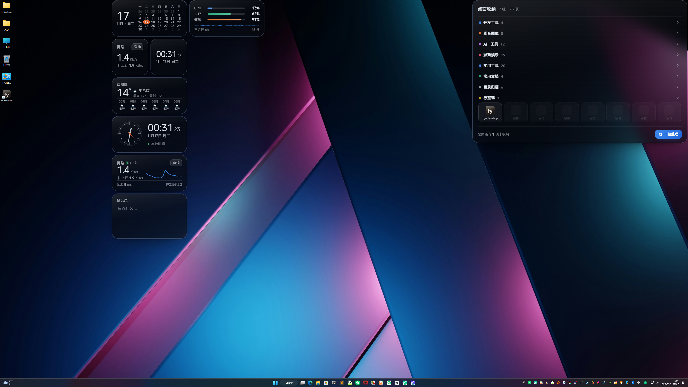
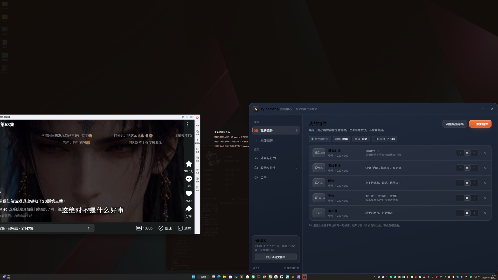

# fy-desktop

> Windows 桌面玻璃小组件 + 桌面快捷方式收纳格子。
>
> 抬眼能看到的信息，一个面板收干净的桌面。



---

## 这是什么

一个常驻桌面底层的透明图层，只做两件事：

**① 七个小组件**——天气、模拟时钟、数字时钟、日历、系统监视、网络、备忘录。

全部数据自己采，不接第三方 SDK，不上报。可以随时添加、移除、拖动位置、切换小/中/大。

时钟默认显示秒，托盘里可以关。

**② 桌面快捷方式收纳**——按「开发工具 / 设计素材 / 常用文档 / 归档」分组，

把桌面图标**真实移动到** `<桌面>\fy-desktop\<组名>` 文件夹里，

也可以随时移回桌面。移入前遇到重名自动加 `(2)`，绝不覆盖。

不做任务栏、不做 Dock、不做启动器、不做壁纸管理。范围就是这么窄。

## 特性

|  |  |
| --- | --- |
| **真毛玻璃** | 不是半透明白底 + 噪点的模拟。抓底图的一瞬间把窗口从截图中临时排除，抓一张纯桌面底图，降采样 1/3 后做高斯模糊，再按每个卡片的屏幕坐标裁切铺底——所以模糊的是你自己的壁纸，换壁纸就跟着变。排除只持续 ~150ms，其余时间窗口对截图完全可见 |
| **真实图标** | 走 Windows Shell 的 `IShellItemImageFactory` 直接取 64×64 缩略图，`.lnk`、文件夹、文档、图片都是它们本来的样子，不是首字色块 |
| **真移动文件** | 收纳就是 `MoveFile`：同盘 `rename`，跨盘复制后删除。移动前重名检测，移动后可一键移回 |
| **不挡桌面** | 空白区域鼠标穿透，桌面图标、右键菜单、框选照常可用；后端 30ms 轮询光标位置，压到卡片上才接管 |
| **不抢焦点** | `SW_SHOWNOACTIVATE` 显示，点「显示桌面」自动回来，不进 Alt+Tab，不占任务栏 |
| **真数据** | 速率来自 `sysinfo` 网卡字节差分 + EMA，延迟是 TCP 握手 223.5.5.5:443，IP 用 UDP 路由探测取**正在使用的网卡**（不会被 VMware/Hyper-V 虚拟网卡骗到），天气双源（Open-Meteo → wttr.in） |
| **区县级天气** | 双击天气卡可搜中文地名，「西湖区」「德清县」都能命中（photon / OSM 数据，Open-Meteo 自带的地理编码只认拼音） |
| **逐时预报会跨天** | 22 点以后照样能给出接下来 6 个整点（到明天的格子标一个橙点），不是「今天剩几个小时就看几个小时」 |
| **尺寸只有三档** | 小 102×102、中 210×102、大 210×126，宽高都是 6px 吸附网格的整数倍；中/大宽度 = 两个小 + 一条缝（2×102+6=210），两张小卡并排正好顶一张中卡。所有组件共用同一套格子，横着装一排、竖着装一列都能严丝合缝，卡片之间固定留 6px 缝。除备忘额外只保留小/中——多出来的高度只够把内容排松一点，桌面却实打实被占掉了 |
| **右键就是设置** | 右键任意卡片：换尺寸（按该组件支持的档位列出）、换材质（玻璃/暮色/石墨）、调整布局、添加、移除，不用先点托盘里的「编辑布局」 |
| **控制中心** | 托盘左键打开独立窗口，左侧分五页：我的组件 / 添加组件 / 设置 / 分组 / 关于。有任务栏按钮、能 Alt+Tab 切到，桌面上不必再靠一块全屏遮罩接管鼠标。窗口按屏幕宽度自适应（4K 上 1280×880，1080p 上 960×660），拖到哪儿记住在哪儿 |
| **组件库按尺寸分组** | 控制中心「添加组件」页里分小 / 中 / 大三段，每段列出支持该档的组件并画出同比例的预览迷你卡；顶部选材质会全局统一应用，点「小」组里的天气，加出来就是小号，窗口不自动关，可以连着加 |
| **小号只留要紧的** | 天气小号只显示今天的天气与气温，时钟小号只留数字时间，网络小号只报上下行速率，系统小号只报三个百分比——不硬塞 |
| **对齐不靠眼** | 拖动吸 6px 网格，靠近其它卡片边缘时出橙色参考线并自动留缝贴齐，不同组件能对齐成同一条线 |
| **改材质，全场一起变** | 三套材质：玻璃（白膜压在真实壁纸模糊上，能透出壁纸）/ 暮色（深色膜压底图，带壁纸纹理）/ 石墨（中性深灰实底，深色壁纸上不刺眼）。在控制中心里换材质，**桌面所有组件 + 整个控制中心**同时变色；右键某张卡片仍可单独覆盖它的材质 |
| **桌面弹窗不连带主界面** | 双击天气卡改地区、收纳面板新建或重命名分组时，只弹出那个小输入框——控制中心的主界面不会跟着铺开，窗口尺寸和位置也不变，关掉弹窗窗口一起隐藏 |
| **玻璃会跟着壁纸变深浅** | 按整屏平均亮度采样，壁纸偏暗时玻璃卡翻成深玻璃 + 浅字保证可读；暮色 / 石墨是用户明确选的身份，不会被亮度改写 |
| **检查更新** | 控制中心「关于」页里一键检查（数据来自 GitHub Releases），发现新版可下载并静默安装；同页的「自动更新」开关控制启动时是否自动查 |
| **代码签名** | exe 与安装包带 Authenticode 签名 + 时间戳（当前为自签证书，文件可校验防篡改；正式证书只需换一次指纹） |
| **开机自启** | 装完默认就开，写 `HKCU\...\Run`（**不碰 HKLM**，不给别的用户挂幽灵启动项），托盘里随时关 |
| **图标即装即新** | 安装时把 `fy-desktop.ico` 装进应用目录并让快捷方式显式指向它，重装换图标不需要清图标缓存 |
| **单文件安装包** | 2.0 MB NSIS 安装包，per-user 安装到 `%LOCALAPPDATA%\fy-desktop`，不需要管理员权限 |

## 安装

**装包（推荐）**

下载 `fy-desktop_0.9.2_x64-setup.exe` 双击即可。装到当前用户目录，自动创建开始菜单与桌面快捷方式，

首次启动会登记开机自启。

静默安装 / 卸载：

```bat
fy-desktop_0.9.2_x64-setup.exe /S
"%LOCALAPPDATA%\fy-desktop\uninstall.exe" /S
```

**从源码**

前置要求：

| 依赖 | 版本 | 说明 |
| --- | --- | --- |
| Rust | 1.77+（stable） | CI 用 `dtolnay/rust-toolchain@stable` |
| Node.js | 20 | 仓库 CI 用 Node 20，本地建议对齐 |
| WebView2 | 随系统 | Windows 11 自带；Windows 10 需装 Evergreen Runtime |
| MSVC 生成工具 | VS 2022 Build Tools | Rust 在 Windows 上的链接器 |

```bash
npm install
npm run dev      # 开发模式，带 DevTools
npm run build    # 出安装包：src-tauri/target/release/bundle/nsis/
```

启动后**没有主窗口**，一切从托盘开始（橙色四格方块）：**左键**打开控制中心，**右键**是快捷菜单。

## 怎么用

### 托盘

| 操作 | 说明 |
| --- | --- |
| 左键 | 打开 / 收起控制中心（已经在最前面时再点一次收起） |
| 右键 | 贴着图标弹快捷菜单 |

右键菜单：

| 菜单项 | 说明 |
| --- | --- |
| 添加组件… | 打开控制中心的「添加组件」页，按小 / 中 / 大 分组选 |
| 刷新桌面底图 | 换了壁纸后重新抓一张 |
| 天气地区… | 搜索并切换天气地点，支持到区县 |
| 时钟显示秒 | 时钟的时间文字是否带秒，默认开，切换即时生效 |
| 开机自启 | 勾选状态读的是系统注册表真实值 |
| 打开收纳文件夹 | 定位到 `<桌面>\fy-desktop` |
| 设置文件… | 打开 `%APPDATA%\com.fy.desktop\config.json` 所在目录 |
| 关于 fy-desktop… | 打开控制中心的「关于」页：版本、检查更新、自动更新开关、更新源 |
| 退出 fy-desktop | 真退出（关窗口不退出，这是桌面常驻应用） |

### 控制中心



| 页面 | 能做什么 |
| --- | --- |
| 我的组件 | 列出桌面上的全部组件，逐条换尺寸或移除；顶部「调整桌面布局」「＋ 添加组件」 |
| 添加组件 | 小 / 中 / 大 三段，带同比例预览迷你卡；顶部选材质会全局统一应用，点一下即加 |
| 设置 | 材质、界面缩放、天气地区、开机自启、时钟显秒等组件行为，以及配置与日志目录入口 |
| 分组 | 新建 / 重命名 / 上移下移 / 打开目录 / 删除，显示根目录与已收纳数量 |
| 关于 | 版本号、检查更新、自动更新开关、更新源、配置目录、退出应用 |

在控制中心里改组件，改的是**桌面窗口那一份布局**：它把「加哪个组件、换成哪一档」当成意图发给桌面层执行，找空位、吸附、热区、落盘都只有一处实现。

### 组件

- **加**：右键卡片「添加组件…」，或托盘 → 添加组件…，都会打开控制中心的添加组件页；按尺寸分组，点哪一项就按哪一档加
- **换尺寸**：右键卡片 → 小 / 中 / 大（只列该组件支持的档位，当前档打勾）
- **移**：右键卡片 → 调整布局… → 拖动卡片，吸 6px 网格、靠近边缘出橙色参考线；Esc 结束
- **删**：右键卡片 → 移除组件（只剩一张时禁用）
- **布局自动记住了**：所有位置和尺寸写进配置，重启不变
- **网络卡的曲线**：吞吐走势占右侧 2/3，量程自适应，卡片换档它都跟着变

档位与内容（设计像素，实际按屏幕再乘缩放）：

| 组件 | 小 102×102 | 中 210×102 | 大 210×126 |
| --- | --- | --- | --- |
| 天气 | 今天：气温 / 天气 / 高低温 | + 未来 6 小时（可跨天） | 不支持 |
| 模拟时钟 | 数字时间 + 日期（无表盘） | 表盘 + 时间 / 日期 / 时区 | 不支持 |
| 数字时钟 | 时间 + 日期 | 同小，字号更大 | 不支持 |
| 网络 | 上行 / 下行速率 | + 走势图 + 延迟 / IP | 不支持 |
| 系统监视 | CPU / 内存 / 磁盘 百分比 | + 进度条 + CPU 走势 + 运行时长 | 不支持 |
| 日历 | 不支持 | 整月网格（唯一档） | 不支持 |
| 备忘录 | 不支持 | 两行字 | 更高，能写更多 |

### 收纳格子

- **单击**图标 → 打开；**右键** → 打开 / 在资源管理器中显示 / 移出收纳
- **右键分组标题** → 重命名 / 上移 / 下移 / 在资源管理器中打开 / 删除（删前先把内容移回桌面）
- **拖拽**桌面图标到格子上 → 移入该分组（拖进「桌面」分组则是移出）
- 点分组标题行的**任意位置** → 折叠 / 展开（右侧 **⌄** 只是提示；键盘 Tab 到标题行后按 Enter / 空格同样切换）
- **一键整理** → 按名称关键词自动分配，先给预览再执行
- 每个分组就是一个真实文件夹，改名会同步改目录名，用资源管理器进去操作也完全没问题
- **改天气地点**：双击天气卡，或托盘「天气地区…」→ 输入「西湖区」「德清县」这类区县名，选中即生效

> ⚠️ 收纳会真实移动桌面文件。程序保证只移动、不删除、重名不覆盖，但仍建议第一次先在无关紧要的文件上试。

### 首次启动做了什么

1. 按主屏尺寸算布局，`ui = (屏宽 / 1920).clamp(1, 2)`，4K 屏自动放大一档；
2. 抓一张桌面底图，铺到每张卡片下面；
3. 扫描桌面条目，按名称关键词给一个初始分组建议（不动文件）；
4. 拉一次天气，起系统与网络采样。

## 实现要点

细节都在 [docs/design.md](docs/design.md)，这里只放三个容易踩的：

**毛玻璃怎么来的**：Electron/Tauri 的透明窗口拿不到「窗口后面的桌面像素」。做法是先

`SetWindowDisplayAffinity(WDA_EXCLUDEFROMCAPTURE)` 让自己的窗口在抓底图的那
~150ms 里对截图隐形，再 `BitBlt` 抓屏，抓完立刻还原（v0.9.2 起——之前是常开的，
副作用是所有截图工具都拍不到组件）；抓屏后

降采样 1/3、σ=13 高斯模糊，转成 PNG data URL 交给前端；前端按卡片在屏幕上的物理坐标

裁出对应区域，`background-position` 对齐。所以它是**像素级正确**的模糊，不是猜的。

**鼠标穿透怎么做的**：Tauri 的 `set_ignore_cursor_events` 没有 Electron 的 `forward` 选项——

一旦穿透，自己在窗口里也收不到鼠标移动。所以前端把每个卡片的矩形上报给 Rust，

Rust 线程每 30ms 查一次光标位置，进出热区时切换穿透开关。

**开机自启为什么不用插件**：`tauri-plugin-autostart` 把模式写死成 `Dynamic`（先试 HKLM、

失败再退 HKCU）。管理员身份运行时它会**成功写进 HKLM**，于是给这台机器所有用户挂上一个

指向当前用户目录的启动项。这里直接用底层的 `auto-launch`，显式指定 `CurrentUser`。

## 目录结构

```
fy-desktop/
├── src/renderer/                前端（无框架 ESM）
│   ├── index.html               桌面层（常驻、透明、鼠标穿透）
│   ├── hub.html                 控制中心（独立普通窗口）
│   ├── css/app.css              桌面层设计令牌 + 全部样式
│   ├── css/hub.css              控制中心样式（三套材质 + 弹层）
│   └── js/
│       ├── main.js              桌面层：启动编排、布局变换、拖动缩放、编辑态
│       ├── hub.js               控制中心：五页渲染、弹层、窗口尺寸与紧凑弹窗
│       ├── widgets.js           七个组件的模板与数据绑定
│       ├── organizer.js         收纳面板渲染与拖拽
│       ├── bridge.js            invoke / listen 的薄封装 + 启动重试 + 订阅清理 + 诊断
│       ├── fallback.js          渲染层没起来时的兜底错误屏（外部脚本，受 CSP 允许）
│       ├── debug.js             截图/自检探针（FY_SHOT / FY_UI，按需动态加载）
│       └── util.js              转义、走势图、天气图标
├── src-tauri/                   Rust 侧
│   ├── src/
│   │   ├── lib.rs               启动、自检、截图自检、退出信号
│   │   ├── commands.rs          全部 IPC
│   │   ├── consts.rs            业务常量（仓库、探测地址、采样周期、配色）
│   │   ├── http.rs              全局复用的 reqwest 客户端
│   │   ├── config.rs            配置读写、校验归一化与默认布局
│   │   ├── state.rs             共享状态（配置、缩放、热区）
│   │   ├── window.rs            铺满屏幕、穿透守卫、置顶/回底、单实例
│   │   ├── monitor.rs           系统与网络指标采样
│   │   ├── weather.rs           天气双源
│   │   ├── geo.rs               中文地名搜索（photon / OSM）
│   │   ├── update.rs            检查更新与下载安装包
│   │   ├── autostart.rs         开机自启（HKCU）
│   │   ├── tray.rs              托盘
│   │   └── desktop/
│   │       ├── mod.rs           桌面扫描、真实文件夹收纳、路径归属校验
│   │       ├── icons.rs         Shell 图标提取 + 缓存与过期清理
│   │       └── glass.rs         抓屏、模糊、排除自身
│   ├── capabilities/default.json 桌面层权限（事件、穿透、显示隐藏）
│   ├── capabilities/hub.json     控制中心权限（窗口尺寸 / 位置 / 聚焦）
│   ├── nsis/hooks.nsh           安装/卸载钩子
│   ├── scripts/sign.ps1         Authenticode 签名（无证书自动跳过）
│   └── tauri.conf.json          窗口、CSP 与打包配置
├── design/                      视觉基准稿（静态 HTML）
├── docs/                        需求、设计、版本控制、截图
├── scripts/                     shot.mjs / selftest.mjs / check-version.mjs / check-dims.mjs
└── assets/                      应用图标源图
```

## 开发命令

| 命令 | 作用 |
| --- | --- |
| `npm run dev` | 开发模式启动 |
| `npm run build` | 出安装包（NSIS） |
| `npm run check` | `cargo check`，改完 Rust 先跑这个 |
| `npm run test` | `cargo test`：路径归属、配置归一化、版本比较、文件名去重等纯逻辑单测 |
| `npm run check:version` | 校验 package.json / Cargo.toml / tauri.conf.json 三处版本号一致 |
| `npm run check:dims` | 校验后端 `config.rs` 与前端 `widgets.js` 的设计尺寸常量一致 |
| `npm run selftest` | 编译 release 后跑无界面自检（只碰临时目录） |
| `npm run shot` | 截一张真实渲染图到 `docs/app-preview.png` |
| `npm run icon` | 从 `assets/icon.svg` 重新生成 ico / png / icns 全套图标 |

发布流水线（`.github/workflows/release.yml`）在构建前依次跑 `check:version`、`check:dims`、`test`，
任何一步失败都不会出包。

**签名**：构建时自动执行（`tauri.conf.json` 的 `signCommand` → `src-tauri/scripts/sign.ps1`）。
证书指纹按 `FY_SIGN_THUMBPRINT` 环境变量 → `src-tauri/scripts/sign.env.json` 的顺序读取，
都没有就跳过签名继续出包。本机重新生成自签证书：

```bash
powershell -NoProfile -ExecutionPolicy Bypass -File src-tauri/scripts/make-cert.ps1
```

**换成正式证书的清单**（v1.0.0 目标）：

1. 向 CA 申请代码签名证书（OV 或 EV，需要实名/组织验证），导出为带口令的 `.pfx`；
2. 把 `.pfx` 的 base64 与口令分别存成仓库 Secrets（如 `FY_SIGN_PFX_BASE64` / `FY_SIGN_PFX_PASSWORD`）；
3. CI 里先导入证书库再构建：
   `Import-PfxCertificate -FilePath cert.pfx -CertStoreLocation Cert:\CurrentUser\My`，
   取到指纹写进 `FY_SIGN_THUMBPRINT`（`sign.ps1` 按指纹找证书）；
4. 验证结果：`Get-AuthenticodeSignature .\fy-desktop_*-setup.exe | Format-List`，
   `Status` 必须是 `Valid`，且 `SignerCertificate.NotAfter` 晚于发布日期；
5. 时间戳固定走 `https://timestamp.digicert.com`（RFC 3161），证书过期后签名依然有效；
6. 换证书后跑一次 `npm run selftest`，确认安装包路径没有因文件名变化而失效。

**自检**（不需要人看界面，9 项断言，只碰临时目录）：

```bash
FY_SELFTEST=1 src-tauri/target/release/fy-desktop.exe
```

覆盖：桌面扫描 / 移入收纳格 / 移出还原 / 重名不覆盖 / 真实图标 / 桌面底图 / 开机自启开关 / 收纳根可写 / 出口网卡 IP。

**截图**：`FY_SHOT` 指定输出，`FY_SHOT_DELAY` 等页面稳定，`FY_SHOT_RECT="x,y,w,h"` 只截局部放大看细节，

同时写一份同名 `.json` 记录窗口、缩放、各卡片矩形（含网络卡内部盒子），便于核对坐标。

**打开目录**：`FY_OPEN_ROOT=1` 启动即打开收纳根目录，用来单独验证「打开文件夹」这条链路；
每次打开动作（含 ShellExecute 返回码）都会追加到 `%APPDATA%\com.fy.desktop\launch.log`。

## WebView 启动参数

`tauri.conf.json` 的 `additionalBrowserArgs` 只能写成一行字符串（JSON 不支持注释），
逐项说明放在这里：

| 参数 | 用途 | 去掉会怎样 |
| --- | --- | --- |
| `--disable-features=msWebOOUI,msPdfOOUI` | 关掉 WebView2 自带的「下载/PDF」UI 覆盖层 | 透明桌面上可能闪出白色覆盖层 |
| `msSmartScreenProtection` | 关掉 SmartScreen 的内嵌提示层 | 可能盖住组件内容 |
| `CalculateNativeWinOcclusion` | 关掉窗口遮挡计算 | 被别的窗口盖住后 WebView 认为不可见，可能停渲染 |
| `--disable-background-timer-throttling` | 定时器不降频 | 时钟/指标刷新会被降到 1 分钟级 |
| `--disable-renderer-backgrounding` | 渲染进程不降优先级 | 桌面层被挡住时画面卡顿 |
| `--disable-backgrounding-occluded-windows` | 被遮挡的窗口不降级 | 桌面常驻窗口随时可能被遮住，保留有据 |

前三项与后三项都是「桌面常驻 + 透明窗口」这个形态的必要条件，不是随手加的。

## 数据与隐私

- 配置在 `%APPDATA%\com.fy.desktop\config.json`，收纳文件在 `<桌面>\fy-desktop\`。
- 唯一对外请求是天气（Open-Meteo，失败退 wttr.in），只带经纬度；延迟探测只是对 `223.5.5.5:443` 做 TCP 握手。
- 无账号、无遥测、无自动更新回传。
- 不读文件内容，只读桌面目录的**文件名与扩展名**；图标是 Shell 生成的缩略图，留在内存与本地缓存里。

## 文档

| 文档 | 内容 |
| --- | --- |
| [docs/requirements.md](docs/requirements.md) | 需求：目标、范围、功能项、验收标准、里程碑 |
| [docs/design.md](docs/design.md) | 设计：令牌、玻璃实现、布局、组件规格、窗口模型、架构与取舍 |
| [docs/versioning.md](docs/versioning.md) | 版本控制：分支、提交规范、版本号、发布流程 |
| [CHANGELOG.md](CHANGELOG.md) | 变更日志 |
| [design/ui-demo.html](design/ui-demo.html) | 视觉基准稿（浏览器直接打开） |

## 已知限制

1. **桌面图标会盖在卡片上**。窗口在桌面层之下（`alwaysOnBottom`），这是刻意的——不然会挡住你的图标和右键菜单。
   散着 60 多个图标的桌面，左上角就是会打架；收进格子后自然干净。
2. 只铺主屏，副屏不显示。
3. 图标在深色壁纸上偶尔偏白边（Shell 给的缩略图本身带白底，未做二次抠图）。
4. 更新链路依赖 GitHub Releases（`fsdymy1024/fy-desktop`）：仓库还没发版本时，
   「检查更新」会显示失败原因，升级仍用安装包覆盖安装（配置和收纳文件都在用户目录，重装不丢）。
5. 代码签名目前是**自签证书**：签名真实可校验，但 Windows 仍提示「未知发布者」；
   换正式证书只需更新 `src-tauri/scripts/sign.env.json` 里的指纹。
6. 组件尺寸只有三档预设，不能拉成任意宽高——正是为了让你排得整齐。
7. v0.9 之前装过的版本，已有卡片没有自己的材质字段，会**跟随全局材质**；
   想让某张卡固定成别的材质，右键它选一次即可（下一次改全局材质会重新统一）。

## 路线图

| 版本 | 主题 |
| --- | --- |
| v0.8.1 | 修复：点快捷方式误跳「文档」目录（`open_path` 按类型分流） |
| v0.9.0 | 组件级材质、卡片右键换材质、玻璃配色回退 0.7.0 并恢复明暗自适应 |
| v0.9.1 | 材质全局统一应用；浮层可拖动、点外部不关、x 才关 |
| v0.9.2 | 修复：截图工具拍不到桌面组件（截图排除改瞬时开关） |
| v0.9.7 | 三档尺寸对齐 6px 吸附网格（中/大 = 两小 + 一缝）；天气地区与关于窗口放大；浮层改回点遮罩关闭、托盘菜单点外部收回；修复：打开所在位置跳到「文档」 |
| v0.9.8 | 修复「检查更新」永远查不到新版本（release tag 占位符写错 + 资产文件名兜底解析） |
| v0.9.9 | 桌面收纳：正方形格子、每排 7 个、单行标签、右上角「全部折叠/展开」、右键菜单与组件统一 |
| v1.0.0 | 安全与一致性：最小 CSP、文件命令路径归属校验、配置版本号与增量写回、备忘录落盘、单测与 CI 门禁 |
| v1.1.0 | 控制中心：组件库 / 关于 / 设置 / 分组从桌面浮层迁成独立窗口，托盘左键打开；桌面弹窗不再连带主界面 |
| v1.2.0 | 格子内拖拽排序、图标白底抠除、多屏支持、备忘录可编辑、模糊强度可调、正式代码签名证书 |

## 许可

[Apache License 2.0](LICENSE)
