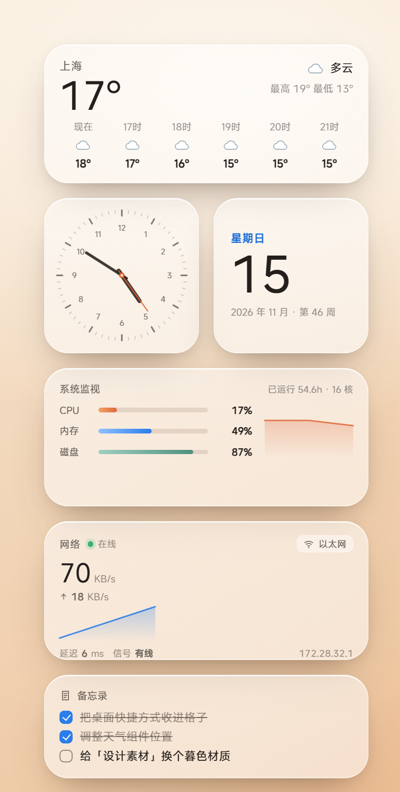
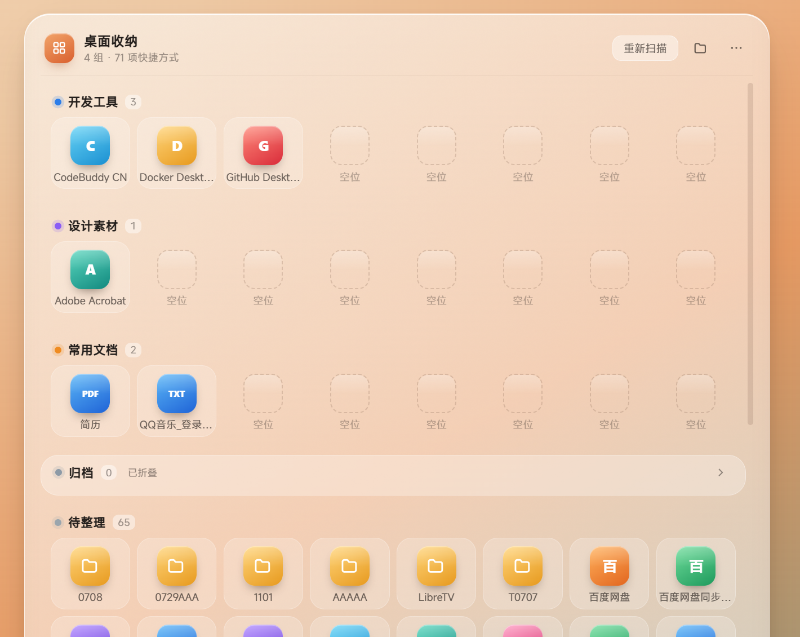

# fy-desktop

> Windows 桌面玻璃小组件 + 桌面快捷方式收纳格子。
> 抬眼能看到的信息，一个面板收干净的桌面。


<p align="center">
  
  
</p>

---

## 这是什么

一个常驻桌面的透明图层，只做两件事：

**① 六个小组件**——天气、模拟时钟、日历、系统监视、网络、备忘录。
全部我自己写的数据采集，不接第三方 SDK，不上报任何数据。

**② 桌面快捷方式收纳**——把散落一地的图标按「开发工具 / 设计素材 / 常用文档 / 归档」归位。
默认只在配置里记归属，**不动你的文件**；点「一键整理」并确认后才真正移动，且可以一键还原。

不做任务栏、不做 Dock、不做启动器、不做壁纸管理。范围就是这么窄。

## 特性

| | |
| --- | --- |
| **真实数据** | 网络速率来自 `netstat -e` 差分，延迟来自 TCP 握手计时，温度来自双源天气接口——不是假动画 |
| **不挡桌面** | 空白区域鼠标穿透，桌面图标、右键菜单、框选照常可用；鼠标移到组件上才接管 |
| **不抢焦点** | 启动不激活窗口，点「显示桌面」也不会被最小化 |
| **三种材质** | 跟随（浅色玻璃）/ 暮色（深色玻璃）/ 原色（近实底），托盘或界面切换，重启保持 |
| **自适应** | 按屏幕工作区自动排布，4K 屏自动放大 1.0–1.75 倍 |
| **可反悔** | 整理前二次确认并列出全部文件；移动写 `_manifest.json`，一键还原 |
| **零原生依赖** | 只要 Electron，`npm install` 完就能跑，不需要 MSVC / Rust 工具链 |

## 快速开始

```bash
cd fy-desktop
npm install

# 国内网络若下载 Electron 二进制卡住，用镜像重跑：
ELECTRON_MIRROR="https://npmmirror.com/mirrors/electron/" node node_modules/electron/install.js

npm start          # 启动
npm run dev        # 启动并打开开发者工具
```

启动后**没有主窗口**，一切从右下角托盘开始（托盘图标是橙色的四格方块）。

## 怎么用

### 托盘菜单

| 菜单项 | 说明 |
| --- | --- |
| 隐藏 / 显示小组件 | 临时收起整个图层 |
| 编辑布局 | 进入编辑模式，拖动任意组件，松手即保存 |
| 材质 | 跟随 / 暮色 / 原色 |
| 重新扫描桌面 | 桌面变化后手动刷新 |
| 打开收纳目录 | 定位到「fy-desktop 收纳区」 |
| 打开配置目录 | `%APPDATA%/fy-desktop` |
| 开机自启 | 登录时静默启动 |
| 重置布局 | 按当前屏幕重新自动排布 |
| 退出 | 完整退出（关窗口不退出，这是桌面常驻应用） |

### 收纳格子

- **单击**图标 → 打开
- **右键**图标 → 打开 / 在资源管理器中显示 / 移入某个分组 / 移出分组
- 点分组右侧 **⌄** → 折叠成一条
- **一键整理** → 列出所有将被移动的文件，确认后移入收纳区
- **还原** → 按记录把文件放回原位置

> ⚠️ 整理会真实移动桌面文件。虽然不删除且可还原，第一次用建议先在一两个无关紧要的文件上试。

### 首次启动做了什么

1. 按屏幕尺寸算出默认布局；
2. 扫描桌面条目，按名称关键词**自动归类一次**（只写归属，不动文件）；
3. 拉一次天气与系统、网络指标。

## 目录结构

```
fy-desktop/
├── src/
│   ├── main/                  主进程
│   │   ├── main.js            启动编排、单实例、截图自检
│   │   ├── window.js          透明窗、鼠标穿透、缩放
│   │   ├── tray.js            托盘菜单
│   │   ├── store.js           配置读写与字段级校验
│   │   ├── layout.js          按屏幕尺寸计算布局
│   │   ├── ipc.js             IPC 注册与采样调度
│   │   └── services/          system / network / weather / shortcuts
│   ├── preload/preload.js     contextBridge 白名单
│   └── renderer/              渲染层（无框架 ESM）
│       ├── index.html
│       ├── css/app.css        设计令牌 + 全部样式
│       └── js/                main / widgets / organizer / overlay / util
├── design/                    视觉基准稿（静态 HTML，定调用）
├── docs/                      需求、设计、版本控制、截图
├── scripts/                   图标生成、截图自检、冒烟测试
└── assets/                    应用与托盘图标
```

## 开发命令

| 命令 | 作用 |
| --- | --- |
| `npm start` | 启动应用 |
| `npm run dev` | 启动 + DevTools |
| `npm run smoke` | 数据层冒烟测试：扫描桌面、系统指标、网络采样（只读，不改文件） |
| `npm run shot` | 用真实窗口渲染一张截图到 `docs/app-preview.png`，用于无人值守验证 UI |
| `npm run icon` | 重新生成 `assets/icon.png` 与 `assets/tray.png` |

> `npm run shot` 支持 `FY_SHOT_RECT="x,y,w,h"` 只截局部，便于放大检查细节：
> `FY_SHOT_RECT="0,0,760,1500" node scripts/shot.mjs docs/left-detail.png`

## 数据与隐私

- 所有数据留在本机：配置在 `%APPDATA%/fy-desktop/config.json`。
- 唯一的对外请求是天气（Open-Meteo / wttr.in），只带经纬度与城市名；经纬度可在配置里改。
- 无账号、无遥测、无自动更新回传。
- 不读取文件内容，只读桌面目录的**文件名与扩展名**。

## 文档

| 文档 | 内容 |
| --- | --- |
| [docs/requirements.md](docs/requirements.md) | 需求：目标、范围、功能项、验收标准、里程碑 |
| [docs/design.md](docs/design.md) | 设计：令牌、玻璃实现、布局、组件规格、窗口模型、架构与取舍 |
| [docs/versioning.md](docs/versioning.md) | 版本控制：分支、提交规范、版本号、发布流程 |
| [CHANGELOG.md](CHANGELOG.md) | 变更日志 |
| [design/ui-demo.html](design/ui-demo.html) | 视觉基准稿（浏览器直接打开） |

## 已知限制

1. **没有真亚克力**：Electron 透明窗口拿不到桌面壁纸，玻璃是「半透明 + 噪点」模拟，不是 DWM 模糊。升级路径见设计文档第 3 节。
2. 快捷方式显示首字色块，不是应用真实图标（解析 `.lnk` 需要原生 COM）。
3. 只铺主屏，副屏不显示。
4. 组件尺寸固定档位，暂不支持拖角缩放。

## 路线图

| 版本 | 主题 |
| --- | --- |
| v0.2.0 | 真亚克力、真实图标、格子内拖拽排序、Alt+Tab 隐藏 |
| v0.3.0 | 组件库面板、多屏支持、备忘录可编辑 |
| v1.0.0 | 安装包与自动更新 |

## 许可

MIT
