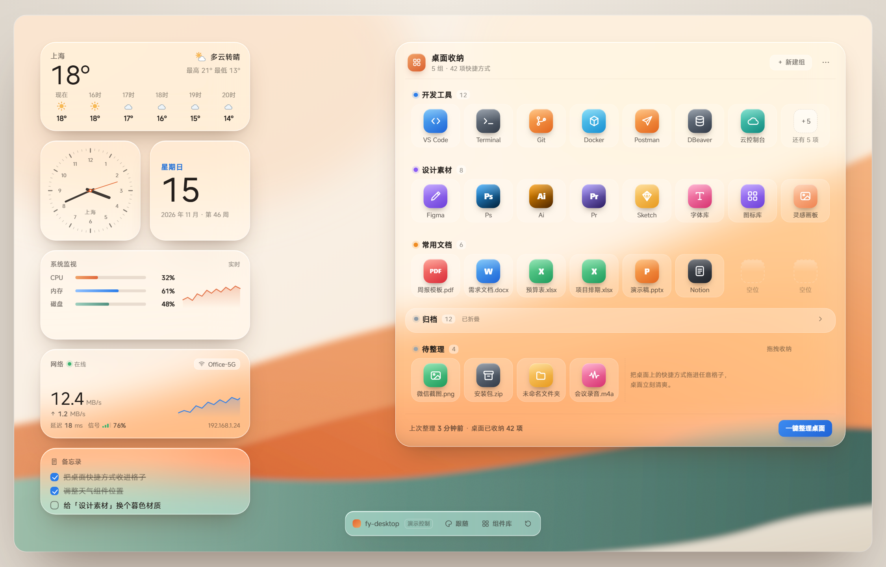

# fy-desktop 设计文档

> 版本：v0.1.0 ｜ 最后更新：2026-11-15



> 上图是 `design/ui-demo.html` 的渲染结果——静态视觉基准稿，用于定调，不含交互逻辑。真实实现见 `docs/app-preview.png`。

## 1. 设计语言

参考 `atrium-desktop` 的「液态玻璃」，但把它收敛成三句话：

1. **暖色底 + 冷色点缀**。壁纸走暖橙，玻璃走乳白，唯一的冷色是状态蓝，用来标记「可交互/当前值」。
2. **数字大、标签小**。信息层级靠字号和透明度拉开，不靠色块和分割线。
3. **轻边界**。1px 半透明白描边 + 顶部内高光，模拟玻璃边缘的折射，不用重阴影压边。

### 1.1 三条硬规则

| 规则 | 说明 |
| --- | --- |
| 一个组件只说一件事 | 天气不说系统、系统不说网络。禁止在卡片里塞次要信息 |
| 主数值只用一种字重 | 主数值 `300`，标签 `500-600`，不使用 `700` 以上的粗体（除非是图标里的字母） |
| 间距只有 4 的倍数 | 组件内部 padding 15/16，卡片间距 16，格位间距 7（例外，格子需要更紧） |

## 2. 设计令牌

所有颜色、圆角、阴影集中在 `src/renderer/css/app.css` 顶部的 `:root`，换肤只改这一块。

| 令牌 | 跟随（浅） | 暮色（深） | 用途 |
| --- | --- | --- | --- |
| `--ink` | `rgba(36,31,28,1)` | `#fff` | 主文字、主数值 |
| `--ink2` | `…,.66` | `rgba(255,255,255,.76)` | 次级文字、标签 |
| `--ink3` | `…,.46` | `rgba(255,255,255,.52)` | 辅助文字、单位 |
| `--glass` | `rgba(255,255,255,.52)` | `rgba(26,19,16,.62)` | 卡片填充 |
| `--stroke` | `rgba(255,255,255,.62)` | `rgba(255,255,255,.18)` | 1px 描边 |
| `--shadow` | 双层暖棕阴影 | 双层纯黑阴影 | 悬浮感 |
| `--accent` | `#2b7de9` | 同 | 状态蓝（选中/链接/进度） |
| `--radius` | `26px` | 同 | 卡片圆角 |

**语义色**（不随材质变）：在线 `#38b26f`、告警 `#e08a2e`、危险 `#d9534f`、CPU 橙 `#e0673a`、内存蓝 `#2b7de9`、磁盘绿 `#4f8f7e`。

## 3. 玻璃是怎么做出来的

**关键约束**：Electron 的透明窗口里，`backdrop-filter` 只能模糊页面内的内容，**拿不到桌面壁纸**，所以下面这条路走不通：

```css
/* ❌ 在透明窗口里不会产生毛玻璃效果 */
backdrop-filter: blur(30px);
```

v0.1 采用**伪毛玻璃**，三层叠加：

```
第 1 层  半透明填充      rgba(255,255,255,.52)
第 2 层  细噪点覆盖      SVG feTurbulence，opacity .05，mix-blend-mode: overlay
第 3 层  边缘与高光      1px 描边 + inset 0 1px 0 rgba(255,255,255,.9)
```

噪点是关键：没有它，半透明填充在大面积纯色壁纸上会像一块塑料；有了 5% 的颗粒，视觉上就被读成「雾面」。

**v0.2 升级路径**（三条，按成本排序）：

1. 读取壁纸文件 + 定位样式，在每个卡片下方按屏幕坐标铺一张模糊副本 → 视觉上最接近真亚克力，纯前端可做。
2. 原生模块调 `SetWindowCompositionAttribute`（ACCENT_ENABLE_ACRYLICBLURBEHIND）→ 只能整窗，会连空白区域一起糊，不适合局部卡片。
3. 换 Tauri + `windows-rs`，自绘窗口并逐区域合成 → 效果最好，但要重写壳层。

## 4. 布局系统

### 4.1 画布

设计基准 **1440×900**（`design/ui-demo.html` 的舞台）。真实运行时窗口铺满整个工作区，坐标以 CSS px 记录在配置里。

### 4.2 自动排布

`src/main/layout.js` 按工作区尺寸计算：

```
外边距 48
左列 x = 48，宽 352
  weather   48,  48   352×150
  clock     48, 214   168×168    calendar 232, 214  168×168
  system    48, 398   352×150
  network   48, 564   352×150
  notes     48, 730   352×112   （高度不足时上移）
收纳面板 x = 屏宽 - 48 - 756，y = 48，宽 756
```

### 4.3 缩放

4K 屏若照搬 1440 的像素值，组件会小得像贴纸。启动时按屏宽算 `zoomFactor = clamp(屏宽 / 1920, 1, 1.75)`，用 `webContents.setZoomFactor` 应用（必须在 `dom-ready` 后设置，否则会被导航重置）。布局坐标用 `工作区尺寸 / zoom` 换算，保证 CSS 坐标系与设计稿一致。

### 4.4 格子系统

收纳面板内部是 8 列网格（可配 4–12），每格宽约 78px：

```
格位   40×40 圆角 11.5 图标 + 10.5px 标签
间距   7px
补位   不足一行用虚线空格补满（"空位"）
```

补满整行是刻意的：参差的最后一排会让「收纳盒」变成「豆腐块」。

## 5. 组件规格

### 5.1 天气（352×150）

```
┌──────────────────────────────┐
│ 上海                   ☁ 多云 │  12 / 12.5px
│ 17°                 最高19最低13│  42/300 · 11
│                              │
│ 现在 17时 18时 19时 20时 21时  │  10.5
│  ☁    ☁    ☁    ☁    ☁    ☁   │  19×19
│ 18°  17°  16°  15°  15°  15°  │  11.5/600
└──────────────────────────────┘
```

数据源双通道：Open-Meteo（结构好，国内常不可达）→ wttr.in（国内可达）。失败时降级为「暂时取不到 / 点击重试」，绝不留空白。

### 5.2 模拟时钟（168×168）

表盘 148×148 居中：60 格刻度（整点更粗更长）、12 个数字（8.5px，透明度 .58）、三根指针（时 34/4.6、分 46/3、秒 48/1.1 且为强调橙）。每秒重绘一次 `transform: rotate`，不做 CSS 过渡（秒针要跳，不要滑）。

### 5.3 日历（168×168）

星期（状态蓝 / 600）、日（54/300，字距 -2）、`2026 年 11 月 · 第 46 周`（10.5/ink3）。周数按 ISO 8601 计算，不是简单除以 7。

### 5.4 系统监视（352×150）

三行指标：`标签（34px）| 进度条（剩）| 数值（40px 右对齐）`，进度条 5px 高、圆角 4、按指标配色。右侧 96×44 面积图显示 CPU 近 22 次采样；首帧用当前值铺满 8 个点，避免出现一条突兀斜线。

### 5.5 网络（352×150）

```
┌──────────────────────────────┐
│ 网络 ● 在线          ⌁ Office-5G│  11 · 10
│ 12.4 MB/s            ╱╲╱╲╱    │  28/300 · 104×42
│ ↑ 1.2 MB/s                    │  10.5
│ 延迟 18 ms  信号 ▮▮▮ 76%  .1.24│  10
└──────────────────────────────┘
```

- **主数值**是下行速率，单位自动换算；上行用 `↑` 前缀弱化，避免两个大数字打架。
- **延迟**按阈值变色（>60 橙 / >120 红），这是用户判断「网卡不卡」的第一信号。
- **有线**时不显示信号条，直接写「有线」，避免 0% 信号让人误以为网络差。
- **走势**用 24 点环形缓冲，服务端预填 0，曲线从平线长起来。

### 5.6 收纳面板（756×自适应）

```
┌─ 桌面收纳 · 4 组 · 71 项 ── 重新扫描 · 目录 · ⋯ ─┐
│ ● 开发工具  3                              ⌄   │
│ [C][D][G][空][空][空][空][空]                  │
│ ● 设计素材  1                              ⌄   │
│ ...                                            │
│ ● 归档  0  已折叠                          ⌄   │  ← 折叠成胶囊
│ ● 待整理  65                               ⌄   │
│ [夹][夹][夹]...                                 │
├────────────────────────────────────────────────┤
│ 桌面共 71 项 · 待整理 65 项      [还原] [一键整理]│
└────────────────────────────────────────────────┘
```

图标生成规则（不解析 `.lnk`，因此不依赖原生 COM）：

| 类型 | 表现 |
| --- | --- |
| 快捷方式 | 名称首字 + 按名称哈希从 10 色板取色 |
| 文件夹 | 琥珀色文件夹字形 |
| 文档/表格/演示 | 蓝/绿/橙底 + `W`/`X`/`P`/`PDF` 徽标 |
| 图片/压缩/音视频 | 对应字形 + 语义色 |
| 其他 | 扩展名前两位 |

## 6. 窗口与交互模型

```
┌────────────────────────────── 屏幕 ──────────────────────────────┐
│                                                                  │
│   ┌─ BrowserWindow（透明、无边框、铺满工作区、不上任务栏）─┐      │
│   │                                                        │      │
│   │   [组件区域]  ← 鼠标进入时 setIgnoreMouseEvents(false)  │      │
│   │                                                        │      │
│   │   其余透明区域 ← 始终 setIgnoreMouseEvents(true,        │      │
│   │                   {forward:true}) 事件穿透到桌面        │      │
│   └────────────────────────────────────────────────────────┘      │
│                                                                  │
└──────────────────────────────────────────────────────────────────┘
```

**穿透的实现**：渲染层监听 `mousemove`，用 `document.elementFromPoint` 判断光标是否落在组件上，变化时通过 IPC 通知主进程切换 `setIgnoreMouseEvents`。`forward: true` 保证窗口在穿透状态下仍能收到鼠标移动事件，否则光标进入组件时无法「唤醒」交互。

**几个必须处理的细节**

| 问题 | 处理 |
| --- | --- |
| Win+D 把窗口最小化 | 监听 `minimize` 立即 `restore()` |
| 启动抢焦点 | `showInactive()` |
| 编辑模式下无法拖动 | 进入编辑时 `setAlwaysOnTop(true, 'floating')` 并强制接管鼠标，退出时还原 |
| Alt+Tab 可见 | v0.1 保留（`skipTaskbar` 只管任务栏）；v0.2 用 `WS_EX_TOOLWINDOW` 处理 |
| 多显示器 | v0.1 只铺主屏；v0.2 支持每屏一个实例或跨屏铺满 |

## 7. 架构

```
┌──────────────── 主进程（Node） ────────────────┐
│  main.js      启动编排 / 单实例 / 截图自检       │
│  window.js    透明窗、穿透、缩放、置底          │
│  tray.js      托盘菜单（与配置双向同步）        │
│  store.js     配置读写 + 校验 + 字段级回退      │
│  layout.js    按屏幕尺寸计算默认布局            │
│  ipc.js       IPC 注册 + 采样调度               │
│  services/                                       │
│    system.js     CPU / 内存 / 磁盘              │
│    network.js    速率差分 / 延迟 / 链路          │
│    weather.js    双源回退 + 15 分钟缓存          │
│    shortcuts.js  桌面扫描 / 分组 / 整理 / 还原   │
└───────────────────┬────────────────────────────┘
                    │ contextBridge（白名单）
┌───────────────────┴────────────────────────────┐
│              渲染层（无框架 ESM）                │
│  main.js       布局、拖拽、穿透判定、材质        │
│  widgets.js    六个组件的渲染与更新              │
│  organizer.js  收纳格子、右键菜单、整理确认      │
│  overlay.js    浮层（右键菜单 / 确认框）         │
│  util.js       速率格式化、图标、SVG 折线        │
└────────────────────────────────────────────────┘
```

### 7.1 IPC 通道

| 通道 | 方向 | 说明 |
| --- | --- | --- |
| `app:boot` | invoke | 取配置、版本、桌面目录、收纳目录（并触发自动布局与首次归类） |
| `ui:interactive` | send | 渲染层上报「光标是否在组件上」，主进程切穿透 |
| `ui:setMaterial` / `ui:setEditMode` | invoke | 材质 / 编辑模式 |
| `ui:saveLayout` / `ui:resetLayout` | invoke | 保存 / 重置布局 |
| `sys:tick` | main→renderer | 每秒系统指标 |
| `net:tick` | main→renderer | 每 2 秒网络快照 |
| `weather:data` | main→renderer | 天气（15 分钟或手动） |
| `desk:list` / `desk:plan` / `desk:tidy` / `desk:restore` | invoke | 扫描 / 整理计划 / 整理 / 还原 |
| `desk:open` / `desk:reveal` / `desk:assign` | invoke | 打开 / 定位 / 改归属 |
| `desk:refresh` | main→renderer | 数据变更后通知重扫 |

### 7.2 配置结构

`%APPDATA%/fy-desktop/config.json`

```jsonc
{
  "version": 1,
  "material": "follow",          // follow | dusk | tone
  "editMode": false,
  "layoutAuto": true,            // true = 每次按屏幕重算；拖动后置 false
  "layout": { "network": { "x": 48, "y": 564, "w": 352, "h": 150 }, ... },
  "widgets": {
    "weather": { "visible": true, "city": "上海", "lat": 31.2304, "lon": 121.4737 },
    "network": { "visible": true, "host": "223.5.5.5", "port": 443 },
    "notes":   { "visible": true, "items": [{ "text": "…", "done": true }] }
  },
  "organizer": {
    "columns": 8,
    "groups": [{ "id": "dev", "name": "开发工具", "color": "#2b7de9" }, ...],
    "assignments": { "C:\\Users\\me\\Desktop\\x.lnk": "dev" },
    "autoAssigned": true
  }
}
```

配置读取做了**字段级降级**：任何一个字段类型不对，就回退到默认值，而不是整个文件作废。写盘做 120ms 防抖，退出前 `flush()` 强写。

## 8. 关键取舍

| 决策 | 选择 | 理由 | 代价 |
| --- | --- | --- | --- |
| 壳层 | Electron 45 | 本机无 Rust 工具链；透明窗 + 托盘 + IPC 开箱可用 | 体积约 200MB |
| 前端框架 | 无（原生 ESM） | 组件数量固定，避免构建链；改一行立即生效 | 复用靠模块，不靠组件树 |
| 图标 | 类型色块 + 首字 | 解析 `.lnk` 需 COM/原生模块，会让「装完即用」变复杂 | 认不出应用本身的图标 |
| 网络速率 | `netstat -e` 差分 | 跨语言可解析、零依赖 | 2s 粒度，瞬时峰值会被平滑掉 |
| 延迟 | TCP 握手计时 | 免管理员权限（ICMP 需要） | 反映的是到指定主机的握手 RTT |
| 整理 | 移动 + manifest | 可还原，最不容易出事 | 不是「虚拟收纳」，文件真的挪走了 |
| 分组 | 虚拟归属（配置里记 path） | 不动文件就能分组，风险最低 | 桌面图标本身不会消失，得靠一键整理 |

## 9. 已知限制

1. **没有真亚克力**：玻璃是「半透明 + 噪点」模拟，不是 DWM 模糊。见第 3 节升级路径。
2. **组件图标不是真图标**：`.lnk` 未解析，显示首字色块。
3. **只铺主屏**：副屏不显示。
4. **Alt+Tab 可见**：窗口未设 `WS_EX_TOOLWINDOW`。
5. **组件尺寸不可调**：固定档位，v0.3 支持拖角缩放。
6. **天气失败无提示细节**：只在卡片上显示「暂时取不到」，具体原因打在主进程日志。

## 10. 后续路线

| 版本 | 内容 |
| --- | --- |
| v0.2.0 | 真亚克力、组件真实图标（`IShellLink` + `SHGetFileInfo`）、收纳格子内拖拽排序、Alt+Tab 隐藏 |
| v0.3.0 | 组件库面板（添加/移除/尺寸档）、多屏支持、备忘录可编辑 |
| v1.0.0 | `electron-builder` 安装包、自动更新、开机自启完善 |
